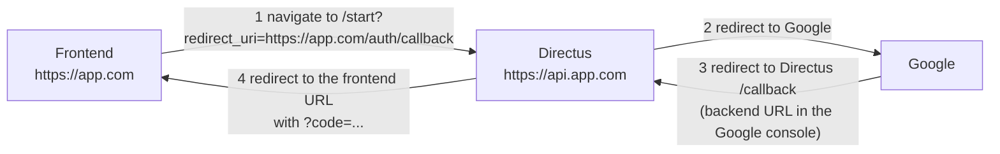
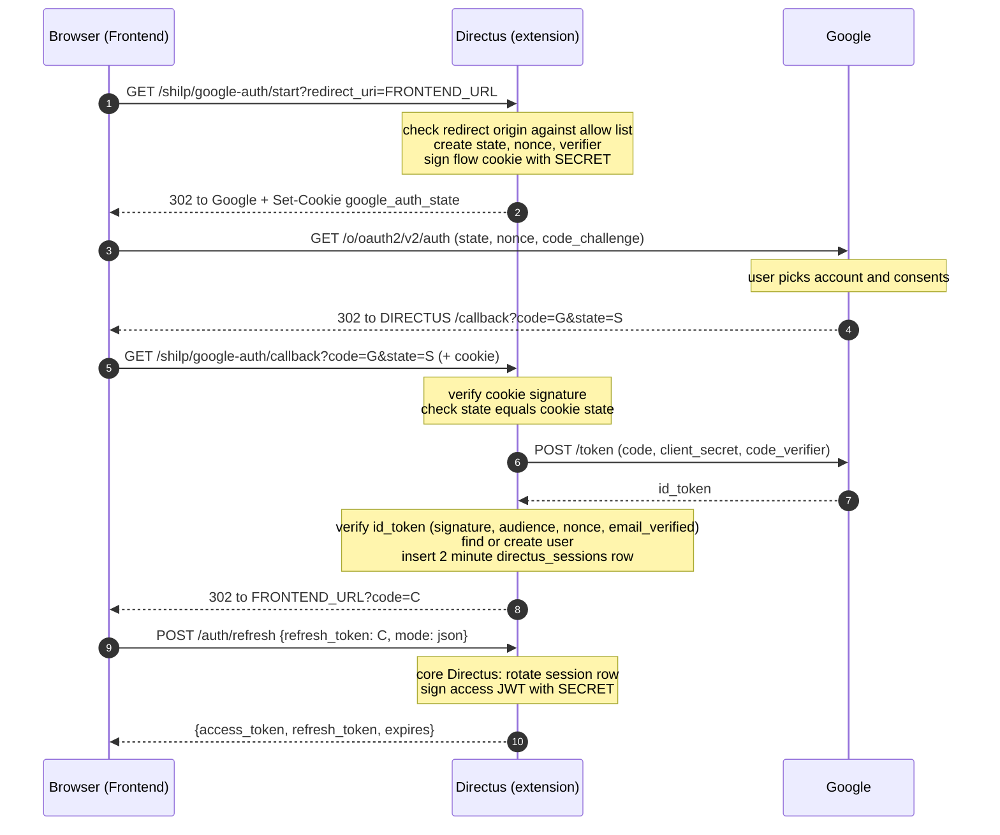
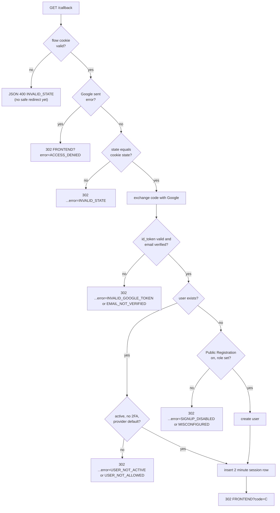
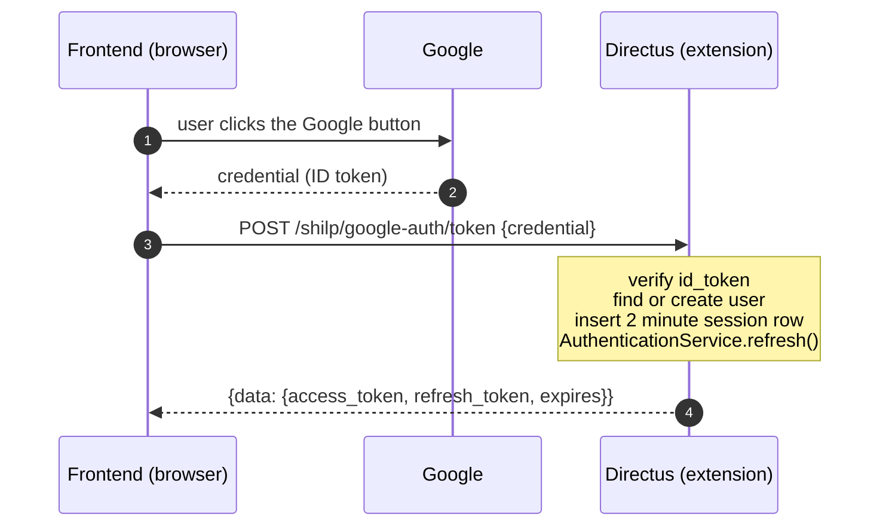
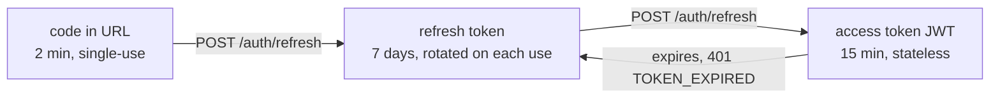

# Auth lifecycle

Everything that happens in a Google login, from the first click to an authenticated API call. Three parties take part:

- **Browser / Frontend**: your app (for example `https://app.com`)
- **Directus**: runs this extension, mounted at `<PUBLIC_URL>/shilp/google-auth`
- **Google**: `accounts.google.com`, `oauth2.googleapis.com`, `www.googleapis.com`

Source files are in `src/`. "Where it happens" below says which side runs each step.

## Which URL belongs to whom

`/shilp/google-auth/callback` is a **Directus backend URL**, not a frontend page. Google redirects the browser to it, the extension handles it on the server, and the browser never renders anything from it: it is always answered with a redirect (or a JSON error). Your frontend has its own, separate URL.

| URL | Belongs to | Set where | Example |
| --- | --- | --- | --- |
| `<PUBLIC_URL>/shilp/google-auth/start` | Directus (extension) | Called by the frontend | `https://api.app.com/shilp/google-auth/start` |
| `<PUBLIC_URL>/shilp/google-auth/callback` | **Directus (extension)** | Registered in the Google console as the **Authorized redirect URI**. Built automatically from `PUBLIC_URL` | `https://api.app.com/shilp/google-auth/callback` |
| `redirect_uri` (query param of `/start`) | **Frontend** | Sent by the frontend. Its **origin** must be in `SHILP_GOOGLE_AUTH_REDIRECT_ALLOW_LIST` | `https://app.com/auth/callback` |



## Endpoints at a glance

| Endpoint | Method | Who calls it | Purpose |
| --- | --- | --- | --- |
| `/shilp/google-auth/start` | GET | Browser (navigation) | Begin the redirect flow, forward to Google |
| `/shilp/google-auth/callback` | GET | Google (via browser redirect) | Finish the redirect flow, hand a one-time code to the frontend |
| `/shilp/google-auth/token` | POST | Frontend (fetch) | Google button / One Tap flow: trade a Google ID token for Directus tokens |
| `/auth/refresh` | POST | Frontend (fetch) | **Directus core, not this extension.** Trade the one-time code for real tokens |
| `/users/me` and any API route | GET... | Frontend (fetch) | **Directus core.** Use the access token |
| `/auth/logout` | POST | Frontend (fetch) | **Directus core.** Delete the session |

## Flow A: redirect flow (`/start` to `/callback`)



Failures after the flow cookie is verified come back the same way, as `302` to `FRONTEND_URL?error=CODE`.

### What `/callback` decides



### Step 1: `GET /shilp/google-auth/start?redirect_uri=<url>`

- **Direction:** Browser to Directus. It must be a full-page navigation, not `fetch`, because the response is a redirect to Google.
- **Payload:** query `redirect_uri`, the frontend URL to come back to.
- **Where:** `src/routes/start.ts`, on the Directus server.
- **Does:**
  1. Reads config from env. If `SHILP_GOOGLE_AUTH_CLIENT_ID` or `_CLIENT_SECRET` is missing it returns `503 NOT_CONFIGURED`.
  2. Checks that the origin of `redirect_uri` is in `SHILP_GOOGLE_AUTH_REDIRECT_ALLOW_LIST`. Otherwise `400 INVALID_REDIRECT`. This stops the endpoint from being an open redirect.
  3. Creates three random values: `state` (CSRF protection), `nonce` (binds the ID token to this attempt), and `verifier` (PKCE secret).
  4. Puts `{ state, nonce, verifier, redirect }` in a JWT signed with Directus's `SECRET`, and sets it as the cookie `google_auth_state` (httpOnly, `SameSite=Lax`, 10 minutes, path = callback path). Nothing is stored on the server.
- **Response:** `302` to `https://accounts.google.com/o/oauth2/v2/auth` with `client_id`, `redirect_uri` (`<PUBLIC_URL>/shilp/google-auth/callback`), `response_type=code`, `scope=openid email profile`, `state`, `nonce`, `code_challenge` (SHA-256 of `verifier`), `code_challenge_method=S256`, `prompt=select_account`.

### Steps 4 to 5: at Google

- **Where:** Google. The user chooses an account and consents.
- **Returns to:** `GET <PUBLIC_URL>/shilp/google-auth/callback?code=<G>&state=<S>` as a browser redirect, or `?error=...` if the user cancelled.

### Step 6 to 10: `GET /shilp/google-auth/callback`

- **Direction:** Google, through the browser, to Directus.
- **Payload:** query `code` (Google's authorization code) and `state`, or `error`. The `google_auth_state` cookie comes with it automatically.
- **Where:** `src/routes/callback.ts`, on Directus.
- **Does, in order:**
  1. Verifies the cookie signature and expiry. Failure returns `400 INVALID_STATE` as a JSON error page, because there is no safe redirect yet. The cookie is cleared.
  2. If Google sent `error`, redirects back with `ACCESS_DENIED`.
  3. Checks that `state` in the URL equals `state` in the cookie. A mismatch means this browser didn't start the flow, which is how CSRF is caught. Error `INVALID_STATE`.
  4. **Server to Google:** `POST https://oauth2.googleapis.com/token` with `code`, `client_id`, `client_secret`, `redirect_uri`, `grant_type=authorization_code`, `code_verifier`. Google checks the verifier against the earlier `code_challenge`. Response: `id_token`. Failure: `GOOGLE_EXCHANGE_FAILED`.
  5. Verifies the ID token with Google's public keys (`https://www.googleapis.com/oauth2/v3/certs`): signature, issuer, audience equals our client id, expiry, and `nonce` equals the cookie's. Failure: `INVALID_GOOGLE_TOKEN`. It also requires a verified email (`EMAIL_NOT_VERIFIED`).
  6. Finds or creates the Directus user (see below).
  7. Inserts a row into `directus_sessions` valid for **2 minutes** and uses its random token as the `code`.
- **Response:** `302` to `<redirect_uri>?code=<C>`. On any failure after step 1 it is `302` to `<redirect_uri>?error=<CODE>`.

### Step 11: `POST /auth/refresh` (Directus core)

- **Direction:** Frontend to Directus.
- **Payload:** `{ "refresh_token": "<C>", "mode": "json" }`
- **Does:** looks up the session row, checks it hasn't expired and that the user is active, then creates a new session row with the full `REFRESH_TOKEN_TTL` (default 7 days), signs an access JWT with `SECRET` (default 15 minutes), and rotates the 2-minute row out so the code works once.
- **Response:** `{ "data": { "access_token", "refresh_token", "expires" } }` (`expires` is in milliseconds).

## Flow B: Google button / One Tap (`/token`)



### `POST /shilp/google-auth/token`

- **Direction:** Frontend (fetch) to Directus.
- **Payload:** `{ "credential": "<Google ID token>" }`
- **Where:** `src/routes/token.ts`, on Directus. The ID token is created in the browser by Google Identity Services, so there is no redirect, `state` or cookie.
- **Does:**
  1. Returns `400 INVALID_PAYLOAD` if `credential` is missing.
  2. Verifies the ID token like step 5 above, but with no nonce check.
  3. Finds or creates the user, inserts a 2-minute session row, then calls Directus's `AuthenticationService.refresh` itself, so the tokens are issued exactly like a normal login.
- **Response:** `{ "data": { "access_token", "refresh_token", "expires" } }`, the same shape as `/auth/refresh`. The frontend does **not** need a second call.
- Add the frontend origin as an **Authorized JavaScript origin** in the Google console for this flow.

## Finding or creating the user

`src/lib/users.ts`, run in `/callback` and `/token`:

1. Look for a `directus_users` row with `provider = 'default'` and `external_identifier = 'google:<sub>'`.
2. If not found, look for a user with the same email (case-insensitive). Google verified the email, so this is treated as the same person.
3. If a user is found:
   - `status` must be `active`, otherwise `USER_NOT_ACTIVE`.
   - `provider` must be `default` and the user must have no 2FA secret, otherwise `USER_NOT_ALLOWED`. This stops Google login from bypassing 2FA or an LDAP/SAML account.
4. If no user is found:
   - Directus's own **Public Registration** setting must be on (`directus_settings.public_registration`), otherwise `SIGNUP_DISABLED`.
   - Its **Public Registration Role** must be set, otherwise `MISCONFIGURED`.
   - The user is created through `UsersService` with no password, status `active`, `provider = 'default'` and `external_identifier = 'google:<sub>'`. Names come from the Google profile.

## After login: using the tokens

| Action | Request | Notes |
| --- | --- | --- |
| Call the API | `GET /users/me` with `Authorization: Bearer <access_token>` | Directus verifies the JWT signature (`SECRET`) and expiry, builds `accountability`, then applies the role's permissions |
| Token expired | Any call returns `401 TOKEN_EXPIRED` | Call `POST /auth/refresh { refresh_token, mode: "json" }`. It returns a new pair and rotates the refresh token. Always store the new one |
| Log out | `POST /auth/logout { refresh_token, mode: "json" }` | Deletes the session row. The access token still works until it expires |

## What is stored where

| Item | Lives in | Lifetime | Revocable |
| --- | --- | --- | --- |
| `google_auth_state` cookie | Browser (httpOnly) | 10 minutes | No, but it is bound to the browser and checked against `state` |
| Google authorization code | Only in the redirect to `/callback` | Seconds, single-use | Google enforces it |
| One-time `code` in `?code=` | `directus_sessions` row | 2 minutes, single-use | Yes (deleted on use) |
| Access token | Client only | 15 minutes by default (`ACCESS_TOKEN_TTL`) | No, stateless JWT |
| Refresh token | `directus_sessions` row and client | 7 days by default (`REFRESH_TOKEN_TTL`) | Yes |



## Security checks at a glance

| Threat | Defence | Where |
| --- | --- | --- |
| Open redirect | Redirect origin must be in the allow list | `/start` |
| CSRF / login forced on a victim | `state` must match the signed cookie | `/callback` |
| Authorization code stolen in transit | PKCE (`code_verifier`) plus the client secret | `/callback` |
| ID token replay | `nonce` check, audience and expiry checks | `/callback` |
| Using an unverified email | `email_verified` must be true | both |
| Leaking tokens through URLs | Only a 2-minute single-use code goes in the URL | `/callback` |
| Bypassing 2FA or SSO accounts | `USER_NOT_ALLOWED` for those users | both |
| Public sign-up when disabled | Respects Directus's Public Registration setting | both |

## Error codes

Redirect flow errors come back as `?error=<CODE>` (after the flow cookie is verified) or as a JSON body (before it). `/token` always returns JSON:

```json
{ "errors": [{ "message": "...", "extensions": { "code": "INVALID_GOOGLE_TOKEN" } }] }
```

| Code | Meaning |
| --- | --- |
| `NOT_CONFIGURED` | Client id/secret or `PUBLIC_URL` is missing |
| `INVALID_REDIRECT` | `redirect_uri` is missing or its origin is not in the allow list |
| `INVALID_STATE` | Cookie missing, expired or tampered, or `state` mismatch |
| `ACCESS_DENIED` | The user cancelled at Google |
| `GOOGLE_EXCHANGE_FAILED` | Google rejected the authorization code |
| `INVALID_GOOGLE_TOKEN` | ID token invalid, expired, wrong audience or wrong nonce |
| `EMAIL_NOT_VERIFIED` | Google account has no verified email |
| `SIGNUP_DISABLED` | New user, but Public Registration is off |
| `MISCONFIGURED` | Public Registration is on but has no role |
| `USER_NOT_ACTIVE` | The Directus user is not `active` |
| `USER_NOT_ALLOWED` | The user has 2FA or belongs to another provider |
| `INVALID_PAYLOAD` | `/token` called without `credential` |
| `INTERNAL_SERVER_ERROR` | Unexpected error, logged by Directus |
